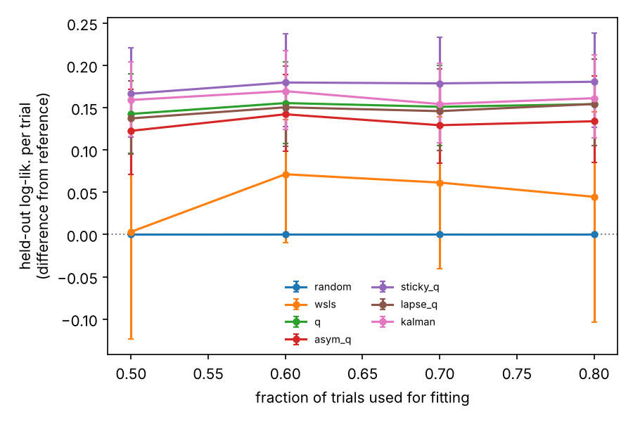
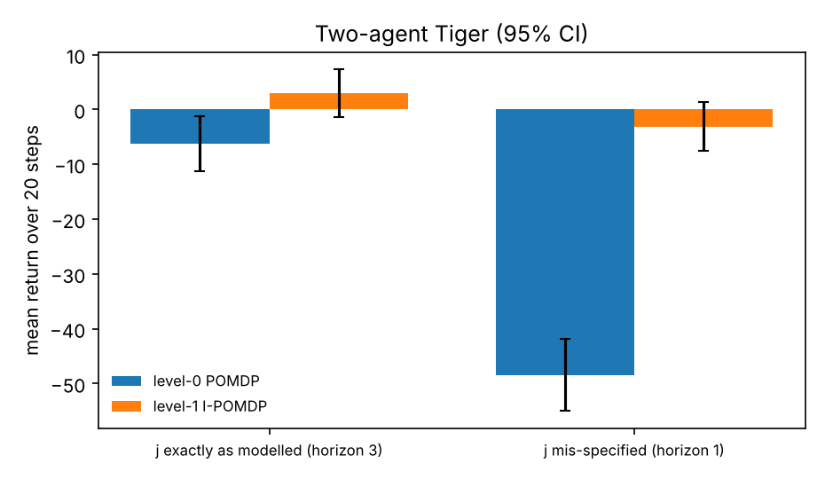

# HumanChoice

**Computational modelling of sequential human choice - with exact tabular planning models (BAMDP, POMDP, I-POMDP) and a
reproducible pipeline to simulate, fit, validate and compare learning models of K-option decisions.**

> **Status: v0.2.2 alpha. No human dataset has been analysed.** Everything below is validated on *synthetic* participants and against analytic
> results. The pipeline for a real-data analysis is built and rehearsed end to end on simulated data, and its analysis is
> [pre-specified](docs/analysis_plan.md); the real dataset still has to be obtained and its licence verified (see [`RESEARCH_NOTES.md`](RESEARCH_NOTES.md)).

## The question

> How well do reward-learning models explain human choices in a changing multi-armed bandit, and does accounting for **asymmetric learning** or
> **choice perseveration** improve predictions of *future* choices?

Answering that responsibly needs more than fitting models: you must know whether the parameters and mechanisms are *identifiable* at the
task's size, whether the winning model reproduces the features of behaviour, and whether it predicts held-out trials. This repository is built
around those checks, and most of its results are about **what a design can and cannot tell you**.

## What is in the repository

| Layer | Packages | Content |
|---|---|---|
| **Planning** (general, behaviour-agnostic) | `mdp`, `bamdp`, `pomdp`, `ipomdp` | exact value/policy iteration; Bayes-adaptive planning (Beta-Bernoulli bandits, Dirichlet/Beta general MDPs); POMDP Bayes filter, exact alpha-vector solving with pruning, QMDP bound; finite level-1 I-POMDP. A [test](tests/unit/test_architecture.py) enforces that this layer never imports the behavioural layer, so it can be extracted unchanged. |
| **Behavioural modelling** | `envs`, `models`, `data`, `simulation`, `fitting`, `recovery`, `comparison`, `evaluation`, `pipelines`, `cli` | K-option choice models, dataset specs with provenance, missed trials, maximum-likelihood fitting, parameter / model recovery, held-out prediction, calibration, predictive checks, likelihood profiles, an end-to-end analysis pipeline and CLI |

**Model ladder** (each row adds one mechanism): random choice -> win-stay/lose-shift -> Q-learning -> {asymmetric, perseverative ("sticky"), lapse} Q-learning;
plus a Kalman-filter Bayesian learner (restless bandits, continuous rewards), a Bayes-adaptive BAMDP agent and a POMDP hidden-state tracker (binary two-option tasks).
Equations and conventions: [`docs/theory.md`](docs/theory.md).

## Install

```bash
git clone <this repository> && cd humanchoice
pip install -e ".[dev]"
pytest
humanchoice list-models
```

Python >= 3.10 (developed on 3.12; the CI matrix covers 3.10-3.12).

## Quick tour

**K options, continuous rewards and timeouts.** Missed trials (`-1`) carry no outcome: no learning and no likelihood contribution.

```python
from humanchoice.envs import RestlessBandit
from humanchoice.fitting import fit_model
from humanchoice.models import StickyQLearning

model = StickyQLearning(n_actions=4)                                   # learning rate, inverse temperature, perseveration
sim = model.simulate([0.35, 6.0, 1.2], RestlessBandit(4), n_trials=300, rng=11, missed_prob=0.04)
fit = fit_model(model, sim["choices"], sim["rewards"], n_starts=4, seed=0)
print({k: round(v, 2) for k, v in fit.params.items()}, "observed trials:", fit.n_obs)
```

**BAMDP: Bayes-optimal exploration.** With two trials left from a uniform prior the optimal value is exactly 13/12; an unknown arm beats an equally good known arm.

```python
from humanchoice.bamdp import BetaBernoulliBanditBAMDP

planner = BetaBernoulliBanditBAMDP(n_arms=2, prior=(1.0, 1.0))
print(planner.value(planner.initial_posterior(), 2))            # 1.0833... = 13/12
q = planner.q_values((1.0, 1.0, 30.0, 30.0), horizon=10)        # (alpha1, beta1, alpha2, beta2): unknown vs well-known arm
print(q[0] - q[1])                                              # > 0: exploration bonus
```

**POMDP: belief tracking and exact planning in the Tiger problem.**

```python
import numpy as np
from humanchoice.pomdp import tiger_pomdp

tiger = tiger_pomdp(gamma=0.95)
alpha_sets = tiger.solve_finite_horizon(5)                      # exact; alpha_sets[h] is the h-step value function
belief = tiger.belief_update(np.array([0.5, 0.5]), action=0, obs=0)   # listen, hear growl-left
print(belief, alpha_sets[5].action(belief))                     # [0.85 0.15] 0  (0 = listen)
```

**I-POMDP: an agent that models another agent.** Observation index = `growl * 3 + creak`; a creak reveals that the other agent opened a door.

```python
from humanchoice.ipomdp import Level1IPOMDP, multiagent_tiger
from humanchoice.pomdp import tiger_pomdp

game = multiagent_tiger()
agent = Level1IPOMDP(game["T"], game["O_i"], game["R_i"], game["O_j"], tiger_pomdp(gamma=0.95), gamma=0.95, depth=8)
belief = agent.update(agent.initial_belief(), action_i=0, obs_i=0 * 3 + 1)   # listen: growl-left + creak-right
print(agent.state_marginal(belief), agent.q_values(belief, 3))
```

**Command line** (a real dataset needs a [spec](configs/README.md); `reproduce` without one runs the synthetic rehearsal):

```bash
humanchoice reproduce empirical-bandit --quick --out results/demo      # synthetic rehearsal, no data needed
humanchoice validate-data --spec configs/my_dataset.json                # schema + data-quality summary, fails loudly
humanchoice fit --spec configs/my_dataset.json --out results/my_dataset --jobs 4 --env my_pkg.my_env:make_env   # --env = task-matched environment
humanchoice sensitivity --spec configs/my_dataset.json --out results/my_dataset_sensitivity --jobs 4
```

If the data carry a `condition` column (reward-drift schedule) `fit` writes `pooled/` **and** one folder per schedule; `--recovery-gate` labels each parameter *interpretable / unreliable / not assessed*;
the analysis plan is bundled in the package and hashed with the results.

`fit` refuses to run while any provenance field of the spec is still marked `VERIFY`. More walk-throughs: [`examples/`](examples). **What to do next, step by step: [`docs/NEXT_STEPS.md`](docs/NEXT_STEPS.md).**

## Findings from the synthetic studies

All results come from `sh experiments/run_all.sh` (seeds, versions and sizes in `results/*_config.json`). **None concerns human behaviour.**

### 1. Rehearsing the pre-specified analysis (Experiment 9)

60 simulated participants (18 Q-learning, 12 asymmetric, 18 perseverative, 12 lapsing), 4 options, 150 trials, 3 % timeouts, Gaussian restless bandit.
Full auto-generated report: [`results/empirical_rehearsal/report.md`](results/empirical_rehearsal/report.md).

| Model | Held-out log-lik. / trial (fit on first 70 %) | Paired difference from chance [95 % CI] |
|---|---|---|
| random | -1.386 | 0 |
| WSLS | -1.325 | +0.061 [-0.041, +0.139] |
| Q-learning | -1.235 | +0.151 [+0.106, +0.200] |
| asymmetric Q | -1.257 | +0.129 [+0.084, +0.179] |
| **perseverative Q** | **-1.208** | **+0.179 [+0.129, +0.233]** |
| lapse Q | -1.240 | +0.146 [+0.099, +0.196] |
| Kalman | -1.232 | +0.154 [+0.109, +0.203] |

* **Pre-specified decisions** (primary analysis = the 70 % split, participant-level bootstrap, paired sign-flip permutation p-values, Holm-adjusted over the three primary contrasts; the other splits overlap with it and serve only as sensitivity checks):
  Q beats WSLS - *supported* (adjusted p = 0.021); perseveration beats Q - *supported* (0.021); **asymmetric learning vs Q - *contradicted*** (0.009): the extra parameter costs more in over-fitting than it
  gains, although 20 % of the simulated participants really are asymmetric. Kalman and lapse vs Q (exploratory) are *not supported*. All three other split points agree with every primary verdict. A null or negative
  result on asymmetry at this design is therefore **not evidence against asymmetric learning**.
* **Predictive checks** (7 choice-only statistics, 60 participants): under the *declared* 30 % flag threshold **no learning model is flagged**. Models without perseveration show an *elevated* stay-rate misfit
  (23-27 % of participants, Wilson lower bounds 14-17 % against 5 % chance), below the threshold - a hint that 30 % of the population is perseverative, not a formal flag; the perseverative model shows 0 %. Only the
  baselines are flagged (random 42-65 %, WSLS 47-58 % on choice entropy / option concentration). **Full-session reward checks** (mean / total reward, spread, improvement; 50 simulated sessions per participant in the
  correctly specified environment) show 2-10 % misfit for the learning models, i.e. chance level; simulated sessions reproduce each participant's own timeouts. On real data these checks run only with a task-matched environment (`--env`, which may depend on the participant's reward-drift schedule); otherwise the report says *not run*.
  A **second-seed repeat** (new participant draw and replicates) changed 1 of 49 flag decisions - the *random-choice baseline* sitting at the threshold (30 % vs 32 %); no learning model's flag changed.
* **Truth audit:** BIC recovers the perseverative mechanism for 12 of 18 such participants, but recovers **none** of the 12 asymmetric and none of the 12
  lapsing participants (they are mostly labelled plain Q-learning, some as random) - the model-recovery study below explains why.
* **Parameter uncertainty** (profiles for 6 participants per model, chosen to span the range of fit quality): the learning-rate interval stays *open* inside the bounds for 33-50 % of them; the perseveration interval is closed and narrow for all six.



### 2. Which parameters are identifiable? (Experiment 10)

Spearman correlation between generating and recovered parameters (40 simulated participants per cell, 4 options, 3 % timeouts; sampling error of a single entry is roughly +/-0.2).
The analysis plan (Amendment 2) only allows interpreting a parameter if the **lower 95 % bootstrap bound** of rho is >= 0.7 at the dataset's design, from >= 200 simulated participants per cell; the table below is the earlier 40-participant, point-estimate version and is **preliminary** (`experiments/identifiability --participants 200` produces the headline version).

| Model | Parameter | rho, 75 trials | 150 trials | 300 trials | passes gate at 150? |
|---|---|---|---|---|---|
| Q-learning | learning rate | 0.43 | 0.40 | 0.59 | no |
| Q-learning | inverse temperature | 0.66 | 0.76 | 0.93 | yes |
| asymmetric Q | alpha+ / alpha- | 0.30 / 0.09 | 0.60 / 0.25 | 0.65 / 0.53 | no / no |
| perseverative Q | learning rate | 0.57 | 0.71 | 0.76 | barely |
| perseverative Q | **perseveration kappa** | 0.83 | **0.94** | 0.96 | yes |
| lapse Q | learning rate / inverse temperature | 0.47 / 0.58 | 0.78 / 0.72 | 0.87 / 0.83 | yes / yes |
| lapse Q | **lapse rate** | 0.03 | **0.03** | 0.29 | no |
| Kalman | inverse temperature / uncertainty bonus | 0.79 / 0.62 | 0.94 / 0.71 | 0.97 / 0.75 | yes / barely |
| Kalman | believed volatility (drift ratio) | 0.30 | 0.49 | 0.60 | no |

* Perseveration is the one new mechanism that is cleanly identifiable; **lapse rate and the asymmetry of learning are not** at 150 trials.
* Recovery improves with *volatility*, *number of options* and *trials*: e.g. Q-learning's learning-rate rho is 0.49 / 0.40 / 0.62 for drift SD 0.01 / 0.028 / 0.06 and 0.40 / 0.40 / 0.73 for 2 / 4 / 8 options.
* Confounds: lapse-model errors in alpha and beta correlate at -0.40 and in beta and epsilon at +0.31 (lapses are partly absorbed by noise); no off-diagonal leakage entry between alpha, beta and kappa of the perseverative model exceeds |rho| = 0.24 (the true perseveration biases the learning-rate estimate only mildly, rho = -0.22).
* 54 of 92 (model, parameter, condition) cells fall below Pearson r = 0.6; all are listed in [`results/exp10_identifiability_summary.md`](results/exp10_identifiability_summary.md).

### 3. Which models can be told apart? (Experiment 11)

Four-option restless bandit, 150 trials, 20 datasets per generator; candidates = the ladder; one generator (`full_q`: asymmetric + perseverative + lapsing) matches no candidate.

| Generator | selected correctly (BIC) [Wilson 95 %] | where the rest go |
|---|---|---|
| random | 95 % [76, 99] | |
| WSLS | 100 % [84, 100] | |
| Q-learning | 65 % [43, 82] | random 15 %, Kalman 20 % |
| asymmetric Q | **5 %** [1, 24] | Q-learning 60 % |
| perseverative Q | 55 % [34, 74] | WSLS 30 % |
| lapse Q | **5 %** [1, 24] | Q-learning 70 % |
| Kalman | 80 % [58, 92] | |
| *full Q (mis-specified)* | - | perseverative Q 65 % (its dominant mechanism) |

### 4. Two-option studies (Experiments 1-7, carried over from v0.1 and re-run)

* Behaviour of the models: in a stationary bandit late accuracy peaks at learning rates 0.2-0.4 (0.93-0.94) and falls to 0.81 at 0.95; in a reversal bandit faster learning wins (alpha = 0.7: 0.79); accuracy rises monotonically with beta.
* Recovery in a two-option reversal bandit (60 participants): learning rates r = 0.73-0.88 (Q-learning, 50-400 trials); **inverse temperature has heavy-tailed errors** (Pearson r 0.61 at 200 trials but rho 0.88): a few fits run to the upper bound.
* Model recovery (4 models, BIC): 0.67 at 100 trials, 0.78 at 300; BAMDP and POMDP generators are recovered well, asymmetric Q-learning is the weak spot (0.13 / 0.40).
* Mixed synthetic population: BIC picks the generating model for 30/30 participants, AIC for 28/30; held-out prediction picks it for every generator at every training fraction.

### 5. The planning layer (Experiment 8)

* **POMDP:** exact Tiger solutions with 3, 5, 9, 7, 13 alpha-vectors for horizons 1-5; two independent exact solvers agree to numerical precision.
* **BAMDP:** an uncertain arm's exploration bonus over an equally good known arm grows from 0.079 (2 trials left) to 0.098 (12); Bayes-optimal beats greedy by 0 (<= 3 trials) up to 0.043 expected rewards (12 trials).
* **I-POMDP:** after hearing the other agent open a door the level-1 agent resets its belief (P(tiger left) 0.53) while a level-0 agent stays at 0.999; over 400 simulated two-agent games the level-1 agent earns **+9.2 +/- 5.4** more when the other agent behaves as modelled (an upper bound) and **+45.3 +/- 6.8** when it is mis-specified.



## Validation

**274 tests; 96 % line coverage for the full suite (about 3 min). The fast subset `pytest -m "not slow"` is 256 tests in about 40 s at 85 %.** `ruff` and `mypy` clean; the README's code, the CLI and the installed wheel are exercised by the suite / CI.

* `tests/mathematical_validation/` - hand-derived values; **independent implementations agree** (alpha-vectors vs belief-tree, generic vs bandit BAMDP, value vs policy iteration,
  I-POMDP vs POMDP under a degenerate other agent).
* `tests/unit/` - K-option models (K = 2-7), nesting identities, missed trials (= deleted trials), availability masks, the fast likelihood vs the generic replay, data validation (invalid data must be rejected),
  metrics, diagnostics, architecture boundary.
* `tests/statistical_validation/` - estimator consistency, calibration of the true model, false-positive rate of the predictive checks, information-criterion selection.
* `tests/integration/` - the full simulate -> fit -> recover -> compare pipeline, CLI, README and examples.

**Bugs the tests caught** (all fixed and regression-tested; see [`CHANGELOG.md`](CHANGELOG.md)): a predictive check that flagged the *true* model; an optimiser that left asymmetric Q-learning up to ~40 nats
*worse* than the plain Q-learning model it contains (silently corrupting model comparison) until nested warm starts were added.

## Reproduce

```bash
sh experiments/run_all.sh            # all experiments (resumable); see results/benchmarks.md for cost
sh experiments/run_all.sh --quick    # smoke test; writes to _quick_output/, never touches results/
python experiments/benchmarks.py     # timings: one pass of the ladder over 975 participants ~ 19 CPU-minutes (x ~6 for the full pipeline)
```

## Repository layout

```
src/humanchoice/   mdp bamdp pomdp ipomdp | envs models data simulation fitting recovery comparison evaluation pipelines cli
tests/             unit  integration  mathematical_validation  statistical_validation
experiments/       learning_rate choice_consistency individual_differences parameter_recovery model_recovery model_comparison
                   interactive_models empirical_bandit identifiability model_recovery_ladder benchmarks.py
configs/           dataset-spec template        docs/  theory.md  analysis_plan.md  technical_report.md  NEXT_STEPS.md  published_result_reproduction.md (template)
examples/          00-06 runnable tutorials     results/  figures/  data/synthetic/
```

## Limitations

* No human data yet (see top). Parameter estimates are per-participant maximum likelihood, not hierarchical.
* Several mechanisms (asymmetry, lapse, believed volatility) are **not identifiable at 150 trials** in the simulated design; real-data conclusions about them would need more trials or a more informative task.
* Fixed hyper-parameters (initial values, Kalman noise constants, WSLS threshold) condition all results; sensitivity analyses are declared in the plan but not yet run.
* Exact planning is small-scale; the I-POMDP is a finite level-1 approximation; the "hybrid" model is not the classical two-step model-free/model-based hybrid.
* Details: [`RESEARCH_NOTES.md`](RESEARCH_NOTES.md).

## References

Duff (2002); Ghavamzadeh et al. (2015); Kaelbling, Littman & Cassandra (1998); Cassandra, Littman & Zhang (1997); Littman, Cassandra & Kaelbling (1995); Gmytrasiewicz & Doshi (2005);
Watkins & Dayan (1992); Daw et al. (2006); Wilson & Collins (2019); Palminteri, Wyart & Koechlin (2017). Full list in [`docs/theory.md`](docs/theory.md). Citation: [`CITATION.cff`](CITATION.cff).

## License

MIT
