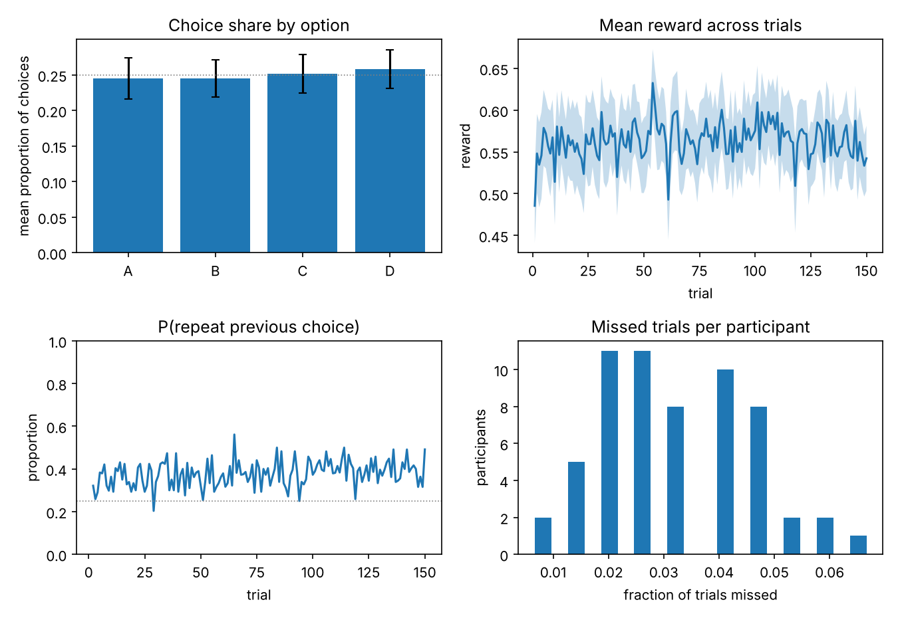
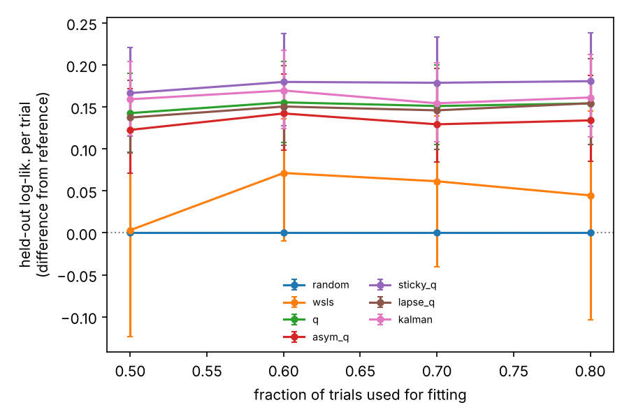
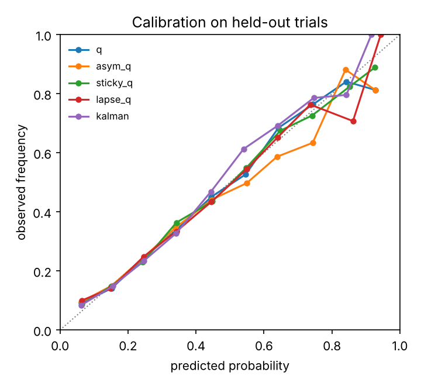
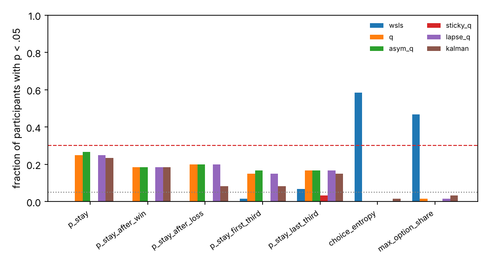

# Empirical-analysis pipeline: synthetic rehearsal

> **SYNTHETIC REHEARSAL - simulated participants with known generating models. NOT human data.**

Generated 2026-11-14T04:47:44+00:00 by humanchoice 0.2.2 (seed 2026).

## 1. Data

60 participants, 9000 trials (150-150 per participant), 4 options. Missed trials: 289 (3.2%); largest per-participant fraction 6.7%. Rewards: mean 0.564, SD 0.172, range [0.000, 1.000] (8689 distinct values).

Preprocessing steps:
- required columns present: participant_id, trial, choice, reward
- marked 289 rows without a response as missed trials (no learning, excluded from likelihood)
- trials are consecutive 1..N for every participant
- validated 60 participants; choices in ['A', 'B', 'C', 'D']

## 2. Model ladder: fit and information criteria

Totals over participants (lower AIC/BIC better). `frac_any_param_at_bound` and `mean_start_agreement` are identifiability/optimisation diagnostics, not goodness of fit.

| model | total_log_likelihood | total_aic | total_bic | mean_aic_weight | n_wins_aic | n_wins_bic | frac_converged | mean_start_agreement | frac_any_param_at_bound |
|---|---|---|---|---|---|---|---|---|---|
| random | -12076.01 | 24152.02 | 24152.02 | 0.061 | 6 | 13 | 1.0 | 1.0 | 0.0 |
| wsls | -11187.147 | 22614.294 | 22971.641 | 0.065 | 4 | 1 | 1.0 | 1.0 | 0.017 |
| q | -10736.114 | 21712.229 | 22069.576 | 0.2 | 23 | 30 | 1.0 | 0.875 | 0.217 |
| asym_q | -10706.811 | 21773.621 | 22309.643 | 0.12 | 2 | 1 | 0.95 | 0.727 | 0.4 |
| sticky_q | -10467.67 | 21295.341 | 21831.363 | 0.33 | 17 | 13 | 1.0 | 0.873 | 0.167 |
| lapse_q | -10713.034 | 21786.068 | 22322.09 | 0.09 | 1 | 0 | 0.967 | 0.907 | 0.7 |
| kalman | -10619.672 | 21599.344 | 22135.366 | 0.134 | 7 | 2 | 1.0 | 0.917 | 0.533 |

## 3. Held-out prediction (primary criterion)

Fit on the first 70% of each participant's trials, predict the rest one step ahead. Log-likelihood per trial with participant-level bootstrap 95% CI; `ll_diff_vs_chance` is the paired difference from uniform choice.

| model | n_participants | test_ll_per_trial | ll_lo | ll_hi | test_brier | test_accuracy | ll_diff_vs_chance | diff_lo | diff_hi |
|---|---|---|---|---|---|---|---|---|---|
| sticky_q | 60 | -1.2075 | -1.2573 | -1.153 | 0.6458 | 0.4798 | 0.1788 | 0.129 | 0.2333 |
| kalman | 60 | -1.232 | -1.2777 | -1.1834 | 0.6587 | 0.4595 | 0.1543 | 0.1086 | 0.2029 |
| q | 60 | -1.2352 | -1.2807 | -1.1861 | 0.6628 | 0.4517 | 0.1511 | 0.1056 | 0.2002 |
| lapse_q | 60 | -1.2404 | -1.2872 | -1.1905 | 0.6646 | 0.4538 | 0.1459 | 0.0991 | 0.1958 |
| asym_q | 60 | -1.257 | -1.3018 | -1.2076 | 0.6761 | 0.4415 | 0.1293 | 0.0845 | 0.1787 |
| wsls | 60 | -1.3249 | -1.4271 | -1.2474 | 0.6904 | 0.4025 | 0.0614 | -0.0408 | 0.1389 |
| chance | 60 | -1.3863 | -1.3863 | -1.3863 | 0.75 | 0.25 | 0.0 | 0.0 | 0.0 |
| random | 60 | -1.3863 | -1.3863 | -1.3863 | 0.75 | 0.2379 | 0.0 | 0.0 | 0.0 |

### Pre-specified contrasts (decision rule of `docs/analysis_plan.md`)

**Primary analysis** = the single split at 70% training: paired participant-level bootstrap difference in held-out log-likelihood per trial; p-values of the three `primary` contrasts are Holm-adjusted, `sanity`/`exploratory` contrasts are not. The other split points overlap with the primary one and are **sensitivity analyses, not independent replications**: `sensitivity_agree` counts how many of them give a CI in the same direction as the verdict.

| hypothesis | status | contrast | mean_diff | ci_lo | ci_hi | p_value | p_adjusted | decision | sensitivity_agree | n_sensitivity_splits |
|---|---|---|---|---|---|---|---|---|---|---|
| H1 | primary | q vs wsls | 0.0896 | 0.0187 | 0.189 | 0.0105 | 0.021 | supported | 3 | 3 |
| H2 | primary | sticky_q vs q | 0.0277 | 0.0077 | 0.0528 | 0.0115 | 0.021 | supported | 3 | 3 |
| H3 | primary | asym_q vs q | -0.0218 | -0.0371 | -0.0092 | 0.003 | 0.009 | contradicted | 3 | 3 |
| H1b | sanity | q vs random | 0.1511 | 0.1041 | 0.2024 | 0.0005 | 0.0005 | supported | 3 | 3 |
| H4 | exploratory | kalman vs q | 0.0032 | -0.0103 | 0.0198 | 0.7231 | 0.7231 | not supported | 2 | 3 |
| H5 | exploratory | lapse_q vs q | -0.0052 | -0.0164 | 0.0025 | 0.3448 | 0.3448 | not supported | 3 | 3 |

Per split point (primary split flagged):

| hypothesis | model | reference | train_fraction | is_primary_split | mean_diff | ci_lo | ci_hi |
|---|---|---|---|---|---|---|---|
| H1 | q | wsls | 0.5 | False | 0.1394 | 0.039 | 0.27 |
| H1 | q | wsls | 0.6 | False | 0.0842 | 0.0261 | 0.1625 |
| H1 | q | wsls | 0.7 | True | 0.0896 | 0.0187 | 0.189 |
| H1 | q | wsls | 0.8 | False | 0.1095 | 0.0197 | 0.2473 |
| H2 | sticky_q | q | 0.5 | False | 0.0239 | 0.0045 | 0.0452 |
| H2 | sticky_q | q | 0.6 | False | 0.0243 | 0.0051 | 0.0467 |
| H2 | sticky_q | q | 0.7 | True | 0.0277 | 0.0077 | 0.0528 |
| H2 | sticky_q | q | 0.8 | False | 0.0265 | 0.0038 | 0.0535 |
| H3 | asym_q | q | 0.5 | False | -0.02 | -0.0332 | -0.0086 |
| H3 | asym_q | q | 0.6 | False | -0.0133 | -0.0297 | -0.0001 |
| H3 | asym_q | q | 0.7 | True | -0.0218 | -0.0371 | -0.0092 |
| H3 | asym_q | q | 0.8 | False | -0.0202 | -0.0354 | -0.0079 |
| H1b | q | random | 0.5 | False | 0.1426 | 0.0979 | 0.1887 |
| H1b | q | random | 0.6 | False | 0.1555 | 0.1111 | 0.2018 |
| H1b | q | random | 0.7 | True | 0.1511 | 0.1041 | 0.2024 |
| H1b | q | random | 0.8 | False | 0.1541 | 0.1042 | 0.2092 |
| H4 | kalman | q | 0.5 | False | 0.0165 | 0.002 | 0.0334 |
| H4 | kalman | q | 0.6 | False | 0.0141 | -0.0016 | 0.033 |
| H4 | kalman | q | 0.7 | True | 0.0032 | -0.0103 | 0.0198 |
| H4 | kalman | q | 0.8 | False | 0.0071 | -0.0095 | 0.0251 |
| H5 | lapse_q | q | 0.5 | False | -0.0053 | -0.0143 | 0.0039 |
| H5 | lapse_q | q | 0.6 | False | -0.005 | -0.0132 | 0.0007 |
| H5 | lapse_q | q | 0.7 | True | -0.0052 | -0.0164 | 0.0025 |
| H5 | lapse_q | q | 0.8 | False | 0.0002 | -0.0034 | 0.0036 |

## 4. Predictive checks (systematic misfit)

### 4a. One-step-ahead checks (choice-only statistics)

Statistics evaluated: choice_entropy, max_option_share, p_stay, p_stay_after_loss, p_stay_after_win, p_stay_first_third, p_stay_last_third. For each, the fraction of participants whose observed value falls outside the model's replicate interval (p < .05); about 5% is expected for a model that captures the feature. A model is **flagged** on a statistic only if the rate exceeds the pre-declared 30% threshold. Rates credibly above chance but below the threshold are called *elevated, below flag threshold* - they are not formal flags.

| statistic | asym_q | kalman | lapse_q | q | random | sticky_q | wsls |
|---|---|---|---|---|---|---|---|
| choice_entropy | 0.0 | 0.02 | 0.0 | 0.0 | 0.65 | 0.0 | 0.58 |
| max_option_share | 0.0 | 0.03 | 0.02 | 0.02 | 0.62 | 0.0 | 0.47 |
| p_stay | 0.27 | 0.23 | 0.25 | 0.25 | 0.57 | 0.0 | 0.0 |
| p_stay_after_loss | 0.2 | 0.08 | 0.2 | 0.2 | 0.13 | 0.0 | 0.0 |
| p_stay_after_win | 0.18 | 0.18 | 0.18 | 0.18 | 0.62 | 0.0 | 0.0 |
| p_stay_first_third | 0.17 | 0.08 | 0.15 | 0.15 | 0.3 | 0.0 | 0.02 |
| p_stay_last_third | 0.17 | 0.15 | 0.17 | 0.17 | 0.42 | 0.03 | 0.07 |

**Flagged (rate above threshold):**

| model | statistic | n_participants | misfit_rate | ci_lower | ci_upper |
|---|---|---|---|---|---|
| random | p_stay | 60 | 0.567 | 0.441 | 0.684 |
| random | p_stay_after_win | 60 | 0.617 | 0.49 | 0.729 |
| random | p_stay_last_third | 60 | 0.417 | 0.301 | 0.543 |
| random | choice_entropy | 60 | 0.65 | 0.524 | 0.758 |
| random | max_option_share | 60 | 0.617 | 0.49 | 0.729 |
| wsls | choice_entropy | 60 | 0.583 | 0.457 | 0.699 |
| wsls | max_option_share | 60 | 0.467 | 0.346 | 0.591 |

**Elevated but below the flag threshold:**

| model | statistic | n_participants | misfit_rate | ci_lower | ci_upper |
|---|---|---|---|---|---|
| random | p_stay_after_loss | 60 | 0.133 | 0.069 | 0.242 |
| random | p_stay_first_third | 60 | 0.3 | 0.199 | 0.425 |
| q | p_stay | 60 | 0.25 | 0.158 | 0.372 |
| q | p_stay_after_win | 60 | 0.183 | 0.106 | 0.299 |
| q | p_stay_after_loss | 60 | 0.2 | 0.118 | 0.318 |
| q | p_stay_first_third | 60 | 0.15 | 0.081 | 0.261 |
| q | p_stay_last_third | 60 | 0.167 | 0.093 | 0.28 |
| asym_q | p_stay | 60 | 0.267 | 0.171 | 0.39 |
| asym_q | p_stay_after_win | 60 | 0.183 | 0.106 | 0.299 |
| asym_q | p_stay_after_loss | 60 | 0.2 | 0.118 | 0.318 |
| asym_q | p_stay_first_third | 60 | 0.167 | 0.093 | 0.28 |
| asym_q | p_stay_last_third | 60 | 0.167 | 0.093 | 0.28 |
| lapse_q | p_stay | 60 | 0.25 | 0.158 | 0.372 |
| lapse_q | p_stay_after_win | 60 | 0.183 | 0.106 | 0.299 |
| lapse_q | p_stay_after_loss | 60 | 0.2 | 0.118 | 0.318 |
| lapse_q | p_stay_first_third | 60 | 0.15 | 0.081 | 0.261 |
| lapse_q | p_stay_last_third | 60 | 0.167 | 0.093 | 0.28 |
| kalman | p_stay | 60 | 0.233 | 0.144 | 0.354 |
| kalman | p_stay_after_win | 60 | 0.183 | 0.106 | 0.299 |
| kalman | p_stay_last_third | 60 | 0.15 | 0.081 | 0.261 |

Second-seed repeat (seed 2027, new participant draw and replicates): largest change in any misfit rate 0.050; 1 of 49 flag decisions changed.

### 4b. Full-session outcome checks (reward statistics)

Mean reward, total reward, reward spread and improvement over the session were checked by simulating whole sessions of each fitted model in the environment supplied for this dataset (it must reproduce the task's reward process). Misfit rates:

| statistic | asym_q | kalman | lapse_q | q | random | sticky_q | wsls |
|---|---|---|---|---|---|---|---|
| mean_reward | 0.02 | 0.03 | 0.03 | 0.03 | 0.2 | 0.02 | 0.17 |
| reward_gain_last_minus_first_third | 0.07 | 0.1 | 0.07 | 0.07 | 0.08 | 0.07 | 0.08 |
| reward_sd | 0.05 | 0.05 | 0.07 | 0.07 | 0.03 | 0.05 | 0.03 |
| total_reward | 0.02 | 0.03 | 0.03 | 0.03 | 0.2 | 0.02 | 0.17 |

## 5. Which parameters may be interpreted?

A parameter is interpretable only if the recovery gate (`docs/analysis_plan.md` §6: lower 95% bound of Spearman rho >= 0.7 at this dataset's design) was passed. Parameters not assessed or failing the gate must **not** be interpreted.

| model | param | median_estimate | frac_at_bound | recovery_status |
|---|---|---|---|---|
| wsls | p_win_stay | 0.406 | 0.0 | NO recovery gate supplied - do not interpret |
| wsls | p_lose_shift | 0.777 | 0.017 | NO recovery gate supplied - do not interpret |
| q | alpha | 0.406 | 0.183 | NO recovery gate supplied - do not interpret |
| q | beta | 4.532 | 0.1 | NO recovery gate supplied - do not interpret |
| asym_q | alpha_pos | 0.488 | 0.317 | NO recovery gate supplied - do not interpret |
| asym_q | alpha_neg | 0.292 | 0.15 | NO recovery gate supplied - do not interpret |
| asym_q | beta | 4.732 | 0.033 | NO recovery gate supplied - do not interpret |
| sticky_q | alpha | 0.398 | 0.117 | NO recovery gate supplied - do not interpret |
| sticky_q | beta | 4.497 | 0.067 | NO recovery gate supplied - do not interpret |
| sticky_q | kappa | 0.048 | 0.0 | NO recovery gate supplied - do not interpret |
| lapse_q | alpha | 0.416 | 0.117 | NO recovery gate supplied - do not interpret |
| lapse_q | beta | 6.075 | 0.067 | NO recovery gate supplied - do not interpret |
| lapse_q | epsilon | 0.0 | 0.617 | NO recovery gate supplied - do not interpret |
| kalman | beta | 3.613 | 0.017 | NO recovery gate supplied - do not interpret |
| kalman | phi | -0.133 | 0.05 | NO recovery gate supplied - do not interpret |
| kalman | drift_ratio | 0.046 | 0.517 | NO recovery gate supplied - do not interpret |

### 5b. Likelihood profiles

`frac_open` is the fraction of profile intervals the data could not close within the parameter bounds (weakly identified).

| model | param | median_relative_width | frac_open | n |
|---|---|---|---|---|
| q | alpha | 0.673 | 0.333 | 6 |
| q | beta | 0.224 | 0.333 | 6 |
| sticky_q | alpha | 0.624 | 0.5 | 6 |
| sticky_q | beta | 0.244 | 0.333 | 6 |
| sticky_q | kappa | 0.091 | 0.0 | 6 |

## 6. Audit against known generating models (synthetic data only)

Rows: generating model; columns: selected model.

| generating model | random | wsls | q | asym_q | sticky_q | lapse_q | kalman | criterion |
|---|---|---|---|---|---|---|---|---|
| asym_q | 2 | 0 | 6 | 0 | 2 | 1 | 1 | aic |
| lapse_q | 1 | 0 | 8 | 0 | 0 | 0 | 3 | aic |
| q | 2 | 0 | 9 | 2 | 2 | 0 | 3 | aic |
| sticky_q | 1 | 4 | 0 | 0 | 13 | 0 | 0 | aic |
| asym_q | 3 | 0 | 8 | 0 | 1 | 0 | 0 | bic |
| lapse_q | 3 | 0 | 7 | 0 | 0 | 0 | 2 | bic |
| q | 3 | 0 | 14 | 1 | 0 | 0 | 0 | bic |
| sticky_q | 4 | 1 | 1 | 0 | 12 | 0 | 0 | bic |

## Deviations from `docs/analysis_plan.md`

None recorded by the pipeline. Any manual deviation made after inspecting real data must be listed here with its reason.

## Limitations

Per-participant maximum-likelihood point estimates; fixed model hyper-parameters; held-out prediction uses chronological splits of one session; see `RESEARCH_NOTES.md`.
